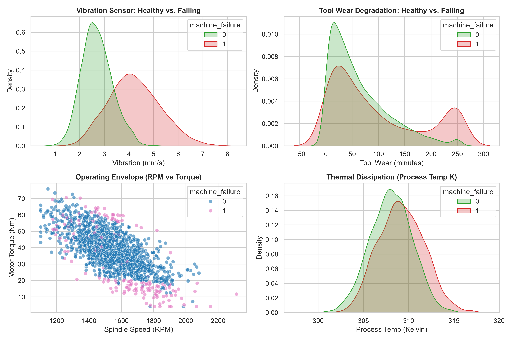
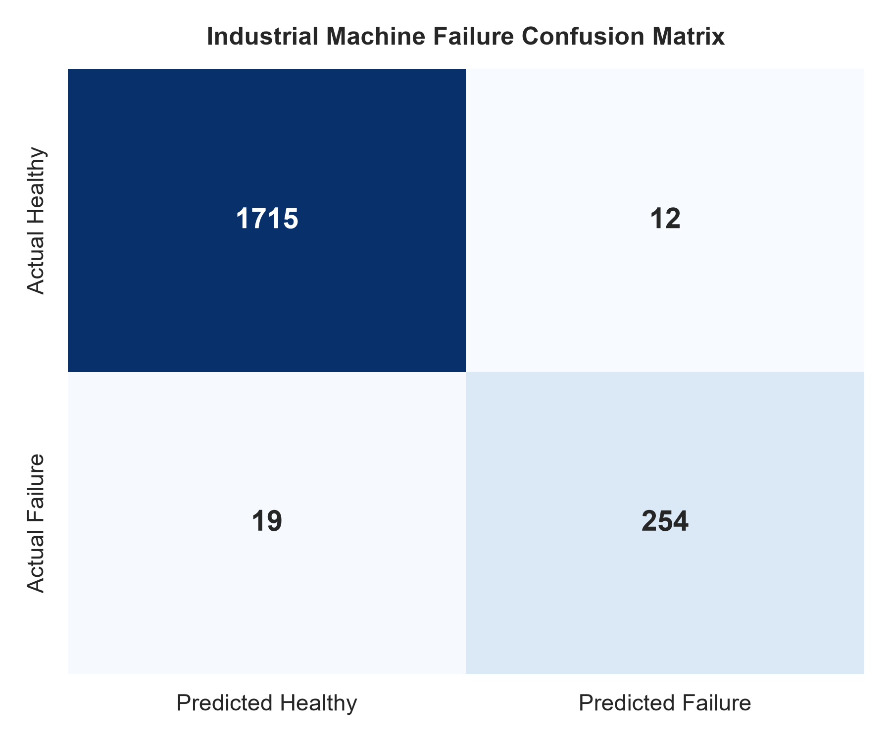
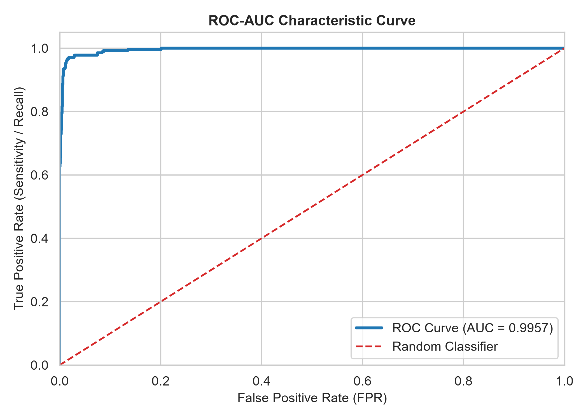
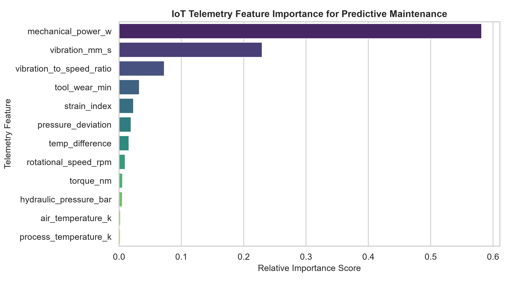
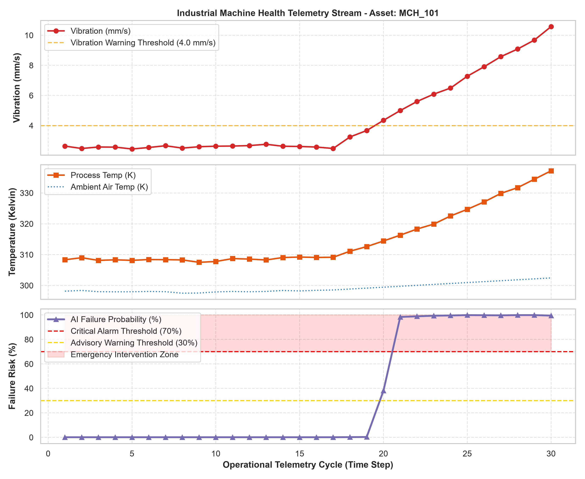

# 🏭 AI-Powered Predictive Maintenance System for IoT Devices

[](https://www.python.org/)
[](https://scikit-learn.org/)
[](https://opensource.org/licenses/MIT)
[]()

> An end-to-end Machine Learning and IoT virtual condition-monitoring system designed to predict industrial equipment failures, prevent unplanned downtime, and optimize maintenance scheduling using physics-informed sensor telemetry.

---

## 📌 Executive Summary & Problem Statement

In industrial manufacturing, power generation, aviation, and automotive plants, **unplanned machinery downtime** costs global industries billions of dollars annually. Traditional approaches rely on:
- **Run-to-Failure (Reactive):** Wait for catastrophic failure, leading to safety hazards, damaged tooling, and extended outages.
- **Calendar-Based (Preventative):** Routine service intervals irrespective of component condition, discarding healthy components prematurely.

**Predictive Maintenance (PdM)** introduces an AI-driven paradigm:
Continuously streaming multi-sensor telemetry (temperature, rotational speed, torque, mechanical vibration, hydraulic pressure) detects subtle sub-surface mechanical degradation signatures **hours or days before catastrophic breakdown occurs**, triggering automated work orders only when needed.

This project delivers a complete virtual simulation pipeline—from synthetic physics-informed sensor generation and feature engineering to multi-model ML benchmarking, automated alerting, and real-time streaming edge dashboards.

---

## 🏗️ System Architecture & Data Flow

```text
+-----------------------------------------------------------------------------------+
|                            VIRTUAL IoT SENSOR TELEMETRY                          |
|  [Air Temp (K)] [Process Temp (K)] [RPM] [Torque (Nm)] [Vibration] [Pressure Bar] |
+------------------------------------------+----------------------------------------+
                                           |
                                           v
+-----------------------------------------------------------------------------------+
|                        PHYSICS-BASED FEATURE ENGINEERING                          |
|  - Delta T (Process - Ambient)       - Mechanical Power: P = Torque * w          |
|  - Overstrain: ToolWear * Torque     - Vibration Harmonic Ratio: Vib / RPM        |
|  - Hydraulic Pressure Anomaly Score  - Standardized Scaling (StandardScaler)      |
+------------------------------------------+----------------------------------------+
                                           |
                                           v
+-----------------------------------------------------------------------------------+
|                         MACHINE LEARNING INFERENCE ENGINE                         |
|     Logistic Regression (Baseline)  -->  Random Forest  -->  Gradient Boosting    |
|               Champion Model: Gradient Boosting (ROC-AUC: 0.9957)                 |
+------------------------------------------+----------------------------------------+
                                           |
                                           v
+-----------------------------------------------------------------------------------+
|                        REAL-TIME TIERED ALERTING & ACTION                         |
|   🟢 Risk < 30%    : Status NORMAL (Continuous Telemetry Monitoring)              |
|   🟡 Risk 30% - 70%: Status WARNING (Maintenance Advisory / Thermal Buildup)      |
|   🔴 Risk > 70%    : Status CRITICAL (Emergency Stop / Automated Work Order)      |
+-----------------------------------------------------------------------------------+
```

---

## 📊 Key Results & Model Performance

We benchmarked three machine learning architectures on an 80/20 stratified split of 10,000 industrial operational cycles:

| Model Architecture | Test Accuracy | Precision (Failure) | Recall (Failure) | F1-Score | ROC-AUC |
| :--- | :---: | :---: | :---: | :---: | :---: |
| **Gradient Boosting (Champion)** | **98.45%** | **95.49%** | **93.04%** | **0.9425** | **0.9957** |
| Random Forest Classifier | 98.20% | 91.29% | 95.97% | 0.9357 | 0.9946 |
| Logistic Regression (Baseline) | 92.35% | 66.76% | 87.55% | 0.7575 | 0.9560 |

*Recall on failure (93.04% - 95.97%) is prioritized because undetected machine failure incurs severe financial and human risk.*

---

## 📈 Visual Proof & Analytics

### 1. Operational Telemetry Distribution & Anomaly Signatures

*Distribution of vibration, tool wear, thermal gradient, and operating RPM comparing healthy vs failing machine states.*

### 2. Confusion Matrix & ROC Curve
| Confusion Matrix | ROC-AUC Curve |
| :---: | :---: |
|  |  |

### 3. Feature Importance & Real-Time Simulation Dashboard
| Feature Importance | Real-Time Edge Simulation |
| :---: | :---: |
|  |  |

---

## 💻 Tech Stack

- **Language:** Python 3.10+
- **Data Engineering:** Pandas, NumPy
- **Machine Learning:** Scikit-Learn (LogisticRegression, RandomForestClassifier, GradientBoostingClassifier, StandardScaler)
- **Visualization:** Matplotlib, Seaborn
- **Serialization:** Joblib, JSON
- **IoT Streaming & Alerting:** Virtual edge stream generator with tiered threshold rules

---

## 🚀 Quickstart & Installation

### 1. Clone the Repository
```bash
git clone https://github.com/<your-username>/AI-Predictive-Maintenance-IoT.git
cd AI-Predictive-Maintenance-IoT
```

### 2. Create and Activate Virtual Environment
**Windows (PowerShell):**
```powershell
python -m venv venv
.\venv\Scripts\Activate.ps1
```

**Linux / macOS:**
```bash
python3 -m venv venv
source venv/bin/activate
```

### 3. Install Dependencies
```bash
pip install -r requirements.txt
```

---

## ⚙️ Running the Project

Run the end-to-end pipeline with a single command:
```bash
python main.py --all
```

Or execute modular pipeline phases independently:

```bash
# 1. Generate 10,000 synthetic IoT sensor records
python main.py --generate-data --samples 10000

# 2. Clean data and compute physics features
python main.py --preprocess

# 3. Benchmark models and serialize the best candidate
python main.py --train

# 4. Generate high-resolution evaluation graphs into /images
python main.py --evaluate

# 5. Launch live virtual IoT streaming telemetry simulation
python main.py --simulate --cycles 30 --delay 0.05
```

---

## 📁 Repository Structure

```text
AI-Predictive-Maintenance-IoT/
│
├── data/
│   ├── raw_sensor_data.csv             # Simulated 10k raw multi-sensor telemetry records
│   └── processed_sensor_data.csv       # Preprocessed dataset with engineered features
│
├── notebooks/
│   └── eda_walkthrough.py              # Exploratory Data Analysis script / notebook
│
├── src/
│   ├── __init__.py                     # Package initialization
│   ├── data_generator.py               # Physics-based sensor data simulation
│   ├── preprocess.py                   # Data cleaning, scaling, and feature engineering
│   ├── train.py                        # Model benchmarking and champion serialization
│   ├── evaluate.py                     # Metric calculation and chart generation
│   └── simulate_stream.py              # Real-time IoT Edge simulation & alerting engine
│
├── models/
│   ├── predictive_maintenance_model.joblib  # Trained Champion ML model
│   └── feature_scaler.joblib                # Fitted StandardScaler
│
├── outputs/
│   ├── model_benchmark_results.csv     # Comparative accuracy, recall, and F1 metrics
│   ├── evaluation_metrics.json         # Full classification report in JSON
│   ├── simulation_stream_log.csv       # Time-series log from live simulator
│   └── simulation_alerts.log           # Timestamped alert dispatch log
│
├── images/
│   ├── confusion_matrix.png            # Visual classification confusion matrix
│   ├── roc_curve.png                   # Receiver operating characteristic plot
│   ├── feature_importance.png          # Relative feature contribution barplot
│   ├── sensor_telemetry_trends.png     # Healthy vs degraded sensor distributions
│   └── simulation_dashboard.png        # Operational health time-series stream plot
│
├── .gitignore                          # Clean Git exclusion rules
├── requirements.txt                    # Project dependency manifest
├── main.py                             # Master CLI pipeline orchestrator
└── README.md                           # Professional project documentation
```

---

## 💡 Industrial Failure Modes Covered

1. **Tool Wear Failure (TWF):** Progressive cutting tool blunting leading to high friction, thermal spikes, and elevated high-frequency vibrations.
2. **Heat Dissipation Failure (HDF):** Insufficient heat convection/cooling causing rapid thermal accumulation under low-speed, high-torque cycles.
3. **Power Surge/Drop Failure (PWF):** Mechanical power $P = \tau \times \omega$ exceeding motor ratings or stalling under load.
4. **Overstrain Failure (OSF):** Critical product of tool wear and mechanical torque exceeding component shear yield limits.
5. **Hydraulic Pressure Anomaly (HPF):** Sudden loss of hydraulic line pressure or dangerous pressure spikes.

---

## 📜 License & Citation

This project is open-source under the [MIT License](LICENSE). Ideal for students, researchers, and engineers demonstrating industrial IoT AI systems.

---

## AUTHOR 
**Author**: **Abhishek Basu — Embedded Systems Student GitHub: [DevAbhay2003](https://github.com/DevAbhay2003?tab=repositories) · LinkedIn: [Abhishek Basu](https://www.linkedin.com/in/abhishek-basu-68b1b1342/)**
